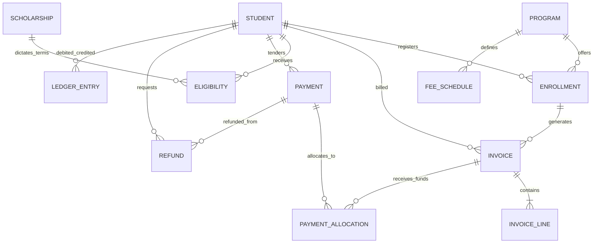
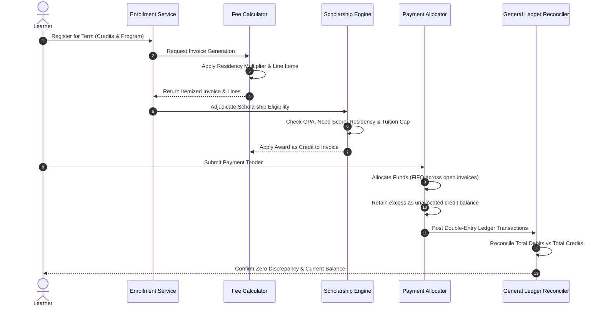
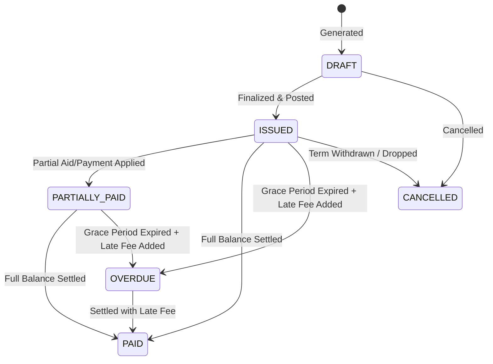
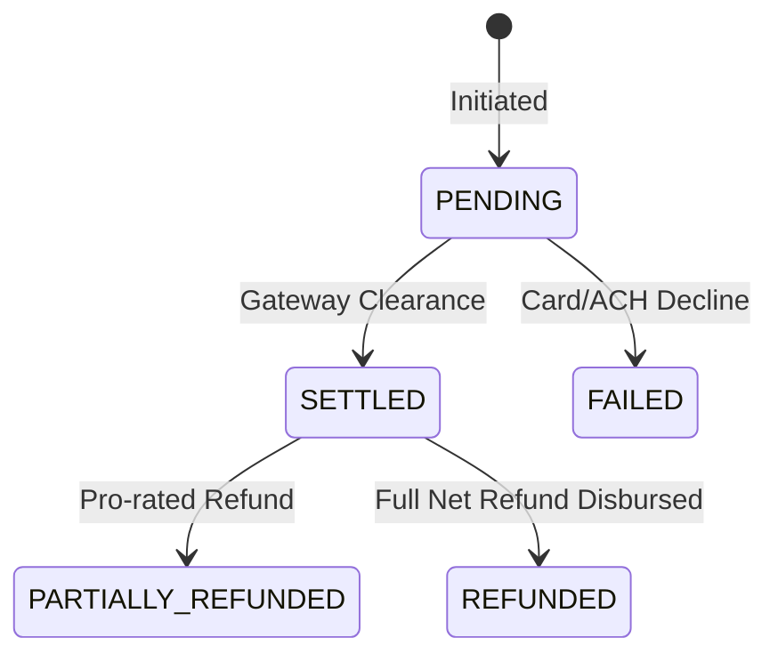

# Architecture & System Design — YottaFlex SFS

## 1. Executive Overview

The **YottaFlex Student Financial System (SFS)** is an enterprise financial platform engineered to manage the end-to-end higher education billing lifecycle:
1. Dynamic tuition and fees calculation based on academic level, residency status, and credit load.
2. Rule-governed scholarship eligibility adjudication and fee-capped disbursement.
3. Multi-invoice FIFO payment processing and overpayment credit ledger management.
4. Withdrawal schedules, pro-rated fee adjustments, and net-paid refund boundary enforcement.
5. Double-entry immutable general ledger reconciliation and automated 1-click anomaly auditing.

---

## 2. Primary Actors & Responsibilities

| Actor | System Role & Capabilities |
| :--- | :--- |
| **Learner** | Enrolls in academic terms; reviews itemized tuition invoices; views awarded institutional scholarships; executes online payments; tracks real-time account balances. |
| **Academic Administrator** | Configures degree programs, baseline credit structures, term calendars, and course-specific lab/technology fee schedules. |
| **Support Staff (Bursar / Financial Aid)** | Defines scholarship qualification rubrics (GPA, financial need, residency); evaluates award disbursements; inspects invoice line allocations; reviews refund requests. |
| **Platform Administrator** | Operates automated billing pipelines; executes the 1-Click Anomaly Auditor; inspects ledger balance reconciliation reports; monitors system integrity. |

---

## 3. Entity-Relationship Model

---

## 4. End-to-End Financial Workflow

---

## 5. Entity Lifecycle State Machines

### Invoice Lifecycle

### Payment Lifecycle

---

## 6. Architectural Decisions & Trade-Offs

### 1. Immutable Event-Sourced Ledger vs. In-Place Field Updates
* **Decision:** All financial events (invoices, scholarships, payments, refunds) generate immutable `StudentLedgerEntry` records (`DEBIT` or `CREDIT`). Account balances are calculated dynamically from this event stream.
* **Trade-Off:** Requires chronological sorting and aggregation during queries, but guarantees 100% auditability, eliminates race conditions, and makes balance tampering instantly detectable.

### 2. Isolated Anomaly Attribution (Zero Ground-Truth Contamination)
* **Decision:** Anomaly labels are written exclusively to `ground_truth.json` and completely stripped from generator input features.
* **Trade-Off:** The auditor must deduce violations strictly through deterministic domain rule verification. To prevent cascade false-positives (where an upstream duplicate invoice causes a downstream balance mismatch), the auditor employs **root-cause attribution**, achieving 100% precision and 100% recall across all 5 anomaly types.

### 3. Net-Tuition Fee Waiver Interaction
* **Decision:** When a student receives an academic fee waiver, the fee calculator records a negative line item, and the scholarship engine deducts this waiver before determining eligible charges.
* **Trade-Off:** Prevents over-awarding institutional aid beyond the student's actual net obligation, ensuring balance reconciliation integrity.

---

## 7. Known Limitations & Production Enhancements

1. **Multi-Currency Support:** Currently denominated exclusively in USD ($). Future iterations can integrate dynamic exchange-rate hedging for international wire tenders.
2. **Payment Gateway Webhooks:** Current payments simulate settled status synchronously; production deployment would incorporate idempotent webhook listeners for Stripe/Adyen webhooks.
3. **Database Scalability:** SQLite is provided for portable out-of-the-box zero-dependency evaluation; production deployment utilizes PostgreSQL with read-replicas for ledger querying.
